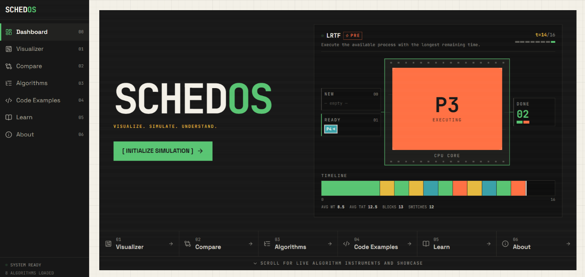
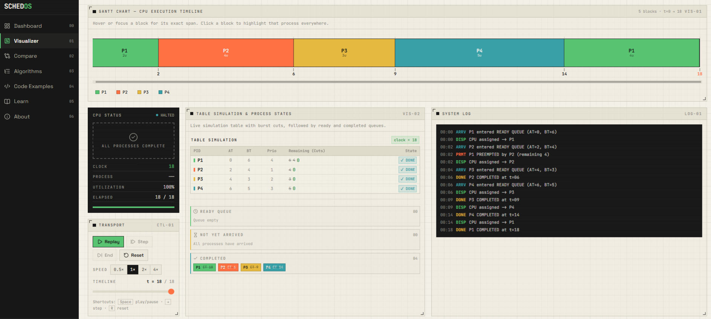
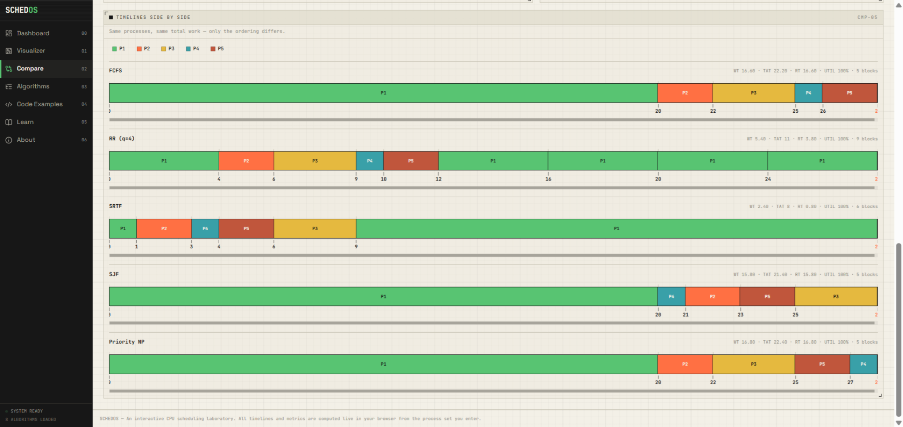
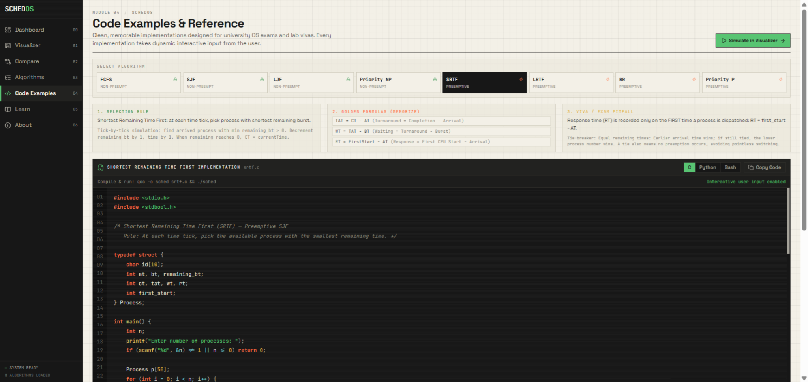
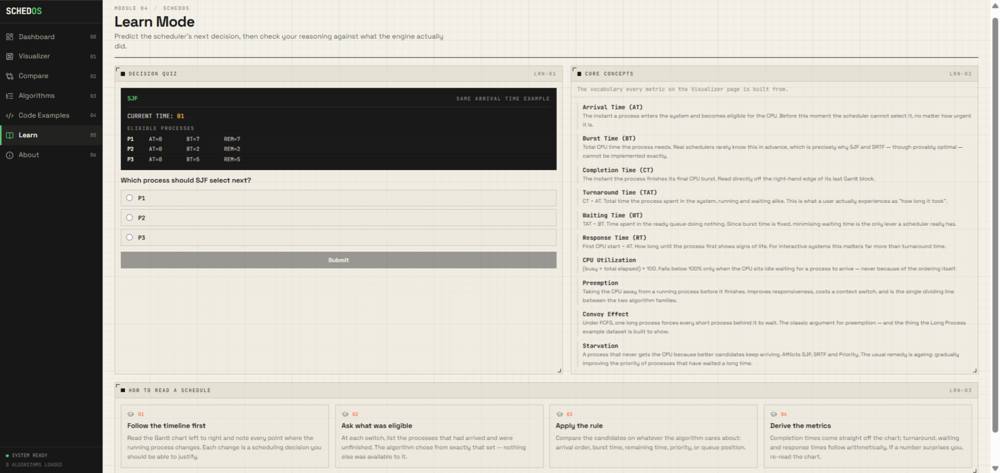

# SchedOS — Interactive CPU Scheduling Laboratory

<p align="center">
  <strong>Visualize. Simulate. Understand.</strong><br>
  An educational operating systems laboratory for simulating, visualizing, and comparing CPU scheduling algorithms in real-time.
</p>

<p align="center">
  <a href="https://fardinhossain.github.io/SchedOS/"></a>
  <a href="https://github.com/fardinhossain/SchedOS"></a>
  <a href="https://github.com/fardinhossain/SchedOS/blob/main/LICENSE"></a>
</p>

<p align="center">
  
  
  
  
  
</p>

<p align="center">
  <a href="https://fardinhossain.github.io/SchedOS/"><strong>Explore Live Demo »</strong></a> •
  <a href="QUICKSTART.md">Quick Start</a> •
  <a href="#-the-eight-scheduling-algorithms">Algorithms</a> •
  <a href="#-visual-tour">Visual Tour</a> •
  <a href="CONTRIBUTING.md">Contributing</a> •
  <a href="https://github.com/fardinhossain/SchedOS/issues">Report Bug</a>
</p>

---

## 📌 Table of Contents

- [Overview](#-overview)
- [Visual Tour](#-visual-tour)
- [Key Features](#-key-features)
- [The Eight Scheduling Algorithms](#-the-eight-scheduling-algorithms)
- [OCR & Smart Process Input](#-ocr--smart-process-input)
- [System Architecture](#-system-architecture)
- [Engine Conventions](#-engine-conventions)
- [Testing & Verification](#-testing--verification)
- [Keyboard Shortcuts](#-keyboard-shortcuts)
- [Getting Started](#-getting-started)
- [Tech Stack](#-tech-stack)
- [Author & Acknowledgments](#-author)
- [License](#-license)

---

## 💡 Overview

Learning CPU scheduling algorithms from static textbook diagrams is often abstract and confusing. **SchedOS** bridges that gap by turning abstract scheduling theory into an interactive, visual, and mathematical laboratory.

Built with **React 19**, **TypeScript**, and **Tailwind CSS v4**, SchedOS runs entirely in the browser with **zero backend dependencies**. It can even be built into a **single standalone HTML file** that operates completely offline.

---

## 🖥️ Visual Tour

### 1. Retro-Future Dashboard & Navigation
High-contrast terminal aesthetic with CRT scanlines, instant telemetry, and curated textbook presets.



---

### 2. Classroom-Style Simulation & Live Gantt Chart
Dynamic step-by-step playback with blackboard-style strike-through notation (e.g. `~5~ ~3~ 1`) matching university exam problem-solving methods.



---

### 3. Multi-Algorithm Benchmark Comparison
Run up to 8 algorithms simultaneously on identical process workloads to compare Turnaround Time, Waiting Time, Response Time, and Context Switches side by side.




---

### 4. Smart Process Table Input & Image OCR
Input process sets manually, load textbook presets, paste tab-separated tables, or upload handwritten notes and textbook screenshots using the built-in OCR scanner powered by Tesseract.js.


---

### 5. Polyglot Code Generator & Interactive Learn Mode
Inspect clean, exam-ready implementations taking live terminal user input in C, Python, and Bash, or test your comprehension with interactive decision quizzes.

<p align="center">
  
  
</p>

---

## 🌟 Key Features

- **🎓 Classroom Blackboard Simulation**: Live table recording remaining burst times with strike-through notation, mirroring real university blackboard and paper calculation methods.
- **⏱️ Cycle-Accurate Gantt Timeline**: Progressive timeline chart displaying exact process boundaries and CPU state transitions tick-by-tick.
- **⚡ Step-by-Step Playback Controller**: Full player controls (`Play`, `Pause`, `Step Forward`, `Step Backward`, `Reset`, and speed slider `0.25x – 4x`).
- **🔍 Smart OCR & Natural Language Table Import**: Upload images or screenshots of process tables to extract Arrival Times, Burst Times, and Priorities with zero manual typing.
- **🔄 Configurable Priority Polarity**: Seamlessly toggle between *"Lower value = Higher priority (1 is highest)"* and *"Higher value = Higher priority"*, supporting all major international textbooks (Silberschatz, Tanenbaum, Stallings).
- **📊 Comparative Benchmarking**: Multi-metric comparison with bar charts, delta tables, and optimal algorithm recommendations for a given workload.
- **💻 Polyglot Code Implementations**: Ready-to-compile reference implementations in C, Python, and Bash.
- **🧠 Interactive Decision Quiz (Learn Mode)**: Evaluates student decision-making against the scheduler engine at key scheduling ticks.
- **🚀 100% Client-Side & Zero-Backend**: Operates completely offline, respects user privacy, and packs into a single 900 KB standalone HTML file.

---

## 📖 The Eight Scheduling Algorithms

| # | Algorithm | Category | Selection Rule | Complexity |
|:---:|:---|:---:|:---|:---:|
| 1 | **FCFS** (First-Come, First-Served) | Non-Preemptive | Executes processes strictly in order of arrival. | $\mathcal{O}(n \log n)$ |
| 2 | **SJF** (Shortest Job First) | Non-Preemptive | Selects available process with lowest burst time; runs to completion. | $\mathcal{O}(n^2)$ |
| 3 | **LJF** (Longest Job First) | Non-Preemptive | Selects available process with largest burst time. | $\mathcal{O}(n^2)$ |
| 4 | **Priority (Non-Preemptive)** | Non-Preemptive | Selects highest-priority available process and runs to completion. | $\mathcal{O}(n^2)$ |
| 5 | **SRTF** (Shortest Remaining Time First) | Preemptive | At each tick, dispatches the process with shortest remaining burst. | $\mathcal{O}(T \cdot n)$ |
| 6 | **LRTF** (Longest Remaining Time First) | Preemptive | At each tick, dispatches the process with longest remaining burst. | $\mathcal{O}(T \cdot n)$ |
| 7 | **Round Robin (RR)** | Preemptive | Cyclic time-sliced FIFO execution using a configurable quantum $q$. | $\mathcal{O}(T)$ |
| 8 | **Priority (Preemptive)** | Preemptive | Dispatches highest-priority process, preempting if a higher-priority arrives. | $\mathcal{O}(T \cdot n)$ |

---

## 📷 OCR & Smart Process Input

SchedOS includes an on-device OCR pipeline using **Tesseract.js** optimized for extracting process tables from homework sheets, lecture slides, and handwritten notes:
- **Image Preprocessing**: Grayscale conversion, adaptive thresholding, and 5-tap Gaussian unsharp masking.
- **Robust Parsing**: Supports markdown tables, CSV/TSV, space-aligned columns, bulleted lists, and natural key-value syntax.
- **Sequence PID Reconciliation**: Intelligently repairs OCR digit ambiguities (e.g. `P1` vs `11`).

---

## 📐 System Architecture

The scheduling engine is written in **pure TypeScript with zero React or DOM dependencies**, ensuring maximum testability and clean separation of concerns.

```
src/
├── algorithms/          # Pure scheduler functions returning SchedulingResult
│   ├── fcfs.ts, sjf.ts, ljf.ts, srtf.ts, lrtf.ts, roundRobin.ts, priority.ts
├── engine/              # Simulation & metrics engine
│   ├── scheduler.ts     # Generic execution runners (non-preemptive, preemptive, RR)
│   ├── metrics.ts       # Derives CT, TAT, WT, RT, utilization from timeline
│   ├── timeline.ts      # Turns execution traces into replayable animation frames
│   ├── validation.ts    # Comprehensive input bounds and sanity validation
│   └── comparison.ts    # Multi-algorithm benchmark comparison engine
├── codeExamples/        # Reference code implementations (C, Python, Bash)
├── components/          # UI components (Gantt, Table Simulation, CPU registers, controls)
├── pages/               # Dashboard, Visualizer, Compare, Algorithms, Code, Learn, About
├── types/scheduling.ts  # Shared domain models and interfaces
├── data/examples.ts     # Curated textbook problem sets
└── test/                # Automated Vitest unit test suite (557 tests)
```

### The Governing Design Rule
> **The Gantt timeline is the single source of truth.** Algorithms emit an execution timeline; `metrics.ts` derives completion ($CT$), turnaround ($TAT$), waiting ($WT$), and response times ($RT$) *strictly from that timeline*. No algorithm calculates its own metrics, eliminating any discrepancy between charts and tables.

---

## ⚙️ Engine Conventions

- **Priority Conventions**: Fully configurable. Supports both *Lower number = Higher priority* (default, e.g. 1 is highest) and *Higher number = Higher priority*.
- **Schedule Start**: Total elapsed time runs from the earliest arrival to final completion. Time before any process exists is not counted as CPU idleness.
- **Deterministic Tie-Breaking**: Primary algorithm key first, then earliest arrival time, then natural process ID order (`P2` precedes `P10`).
- **Round Robin Queue Ordering**: A process arriving at the exact instant a quantum expires is enqueued **before** the preempted process is requeued.
- **Tick-by-Tick Preemption**: Preemptive algorithms re-evaluate at every discrete time unit, modeling real operating system clock ticks.

---

## 🧪 Testing & Verification

```bash
npm run test
```

The test suite contains **557 automated unit tests** across two layers:
1. **Structural Invariants**: Run across every algorithm $\times$ every dataset:
   - Contiguous timeline without invalid gaps or overlaps
   - No process executes before its arrival time
   - Every process receives its exact required burst duration
   - $\text{Total Time} = \text{Busy Time} + \text{Idle Time}$
   - $TAT = CT - AT$
   - $WT = TAT - BT$
   - $RT = \text{First Run Start} - AT$
2. **Hand-Computed Edge Cases**: Pinning exact paper-calculated schedules, arrival ties, CPU idle periods, single-process sets, large burst durations, 50 processes, and extreme Round Robin quanta ($q=1$ and $q > \sum BT$).

---

## ⌨️ Keyboard Shortcuts

| Key | Action |
|:---:|:---|
| <kbd>Space</kbd> | Toggle Play / Pause simulation |
| <kbd>→</kbd> | Step forward one time unit |
| <kbd>←</kbd> | Step backward one time unit |
| <kbd>R</kbd> | Reset simulation to time $t = 0$ |

---

## 🚀 Getting Started

### Prerequisites
- [Node.js](https://nodejs.org/) (v18 or higher recommended)
- `npm`, `pnpm`, or `yarn`

### Installation & Run

```bash
# Clone the repository
git clone https://github.com/fardinhossain/SchedOS.git

# Enter project directory
cd SchedOS

# Install dependencies
npm install

# Start development server
npm run dev
```

Visit `http://localhost:5173` in your browser.

### Building for Production

```bash
npm run build
```

SchedOS produces a **single self-contained `dist/index.html`** file via `vite-plugin-singlefile`. You can double-click this file or distribute it on a USB flash drive — it runs offline with zero server requirements!

---

## 🛠️ Tech Stack

| Layer | Technologies |
|:---|:---|
| **Core Framework** | React 19, TypeScript |
| **Styling & Theme** | Tailwind CSS v4, Retro Terminal aesthetic |
| **Bundler** | Vite, `vite-plugin-singlefile` |
| **Charts & Metrics** | Recharts |
| **Optical Character Recognition** | Tesseract.js |
| **Syntax Highlighting** | PrismJS |
| **Icons** | Lucide React |
| **Test Framework** | Vitest (557 unit tests) |

---

## 👨‍💻 Author

**Fardin Hossain**
- GitHub: [@fardinhossain](https://github.com/fardinhossain)
- Email: iamfardin.swe@gmail.com

---

## 📄 License

This project is open-source and distributed under the [MIT License](LICENSE).
